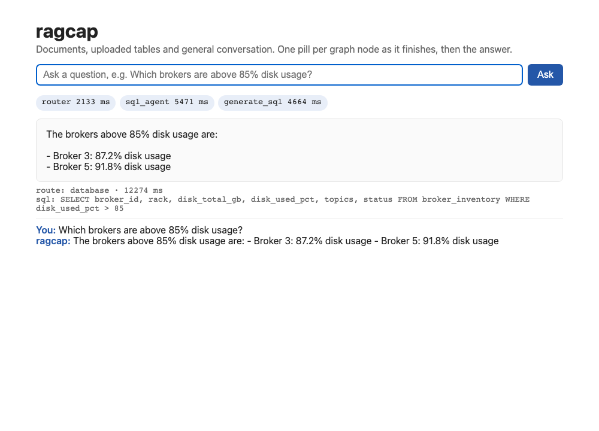
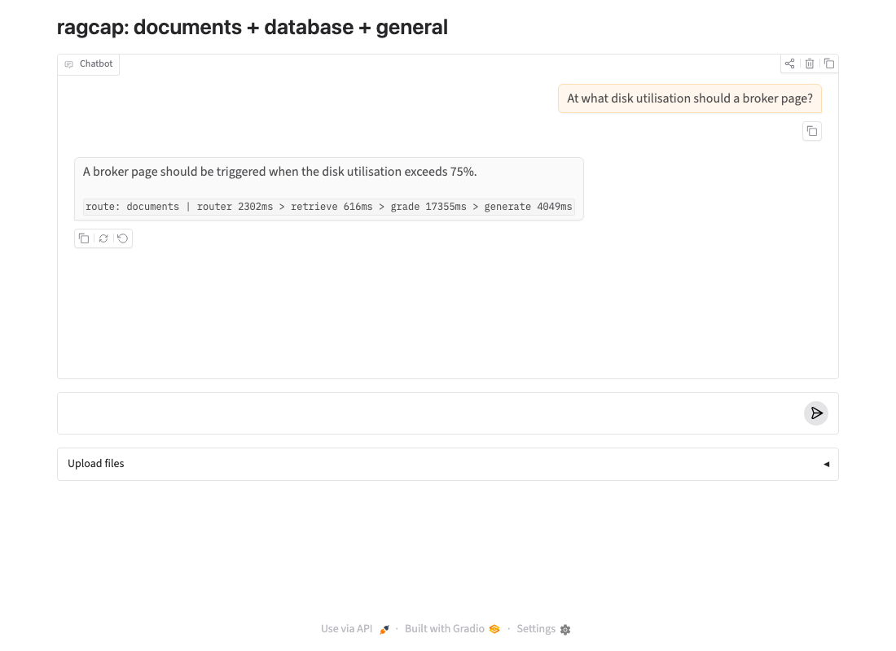
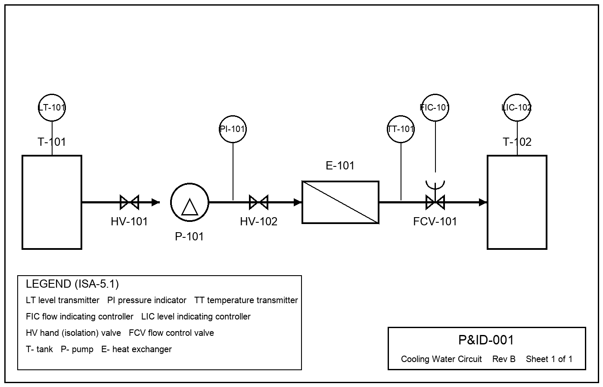

# ragcap

Live showcase (static, recorded runs): https://shreenathacc22.github.io/ragcap/  ·  Vercel: see docs (SOP step 25) to import this repo; `vercel.json` serves `site/`.

A reproduction of Kumar's RAG Capstone design (LangGraph router, document RAG with grade/rewrite, SQL agent, general agent, Postgres + pgvector, FastAPI, Gradio) on local models, plus a frozen evaluation set with quality metrics and a version-aware retrieval filter.

- Rebuild from zero and run every scenario: [docs/RECREATE.md](docs/RECREATE.md) (PDF: `docs/RECREATE_ragcap.pdf`); one command: `./recreate.sh`
- How it was built, every step with evidence: `docs/SOP_ragcap_build.pdf`
- Operating and troubleshooting: `docs/RUNBOOK_ragcap_operations.pdf`
- Needs: Docker Desktop, Ollama (`llama3.2:3b`, `nomic-embed-text`), Python 3.12. No API key, no GPU.
- Headline results (llama3.2:3b, this Mac): router 100% / answers 85-93% on the tuned set; router 96% / answers 80-84% on the unseen set; version filter: superseded chunks 51.6% to 0.0%, control cases flat, +1 ms.

- Interfaces: a static page on the streaming API (`web/`, served at `/`) and a Gradio chat (`ui.py`). Optional LangSmith tracing (`LANGSMITH_TRACING=true`).
- P&ID branch: synthetic drawings with ground truth (`pid/`), vision-model descriptions into the same index, measured in `results/pid_eval_summary.md`.

Secrets: `.env` holds the database password and is gitignored. Never commit it.
